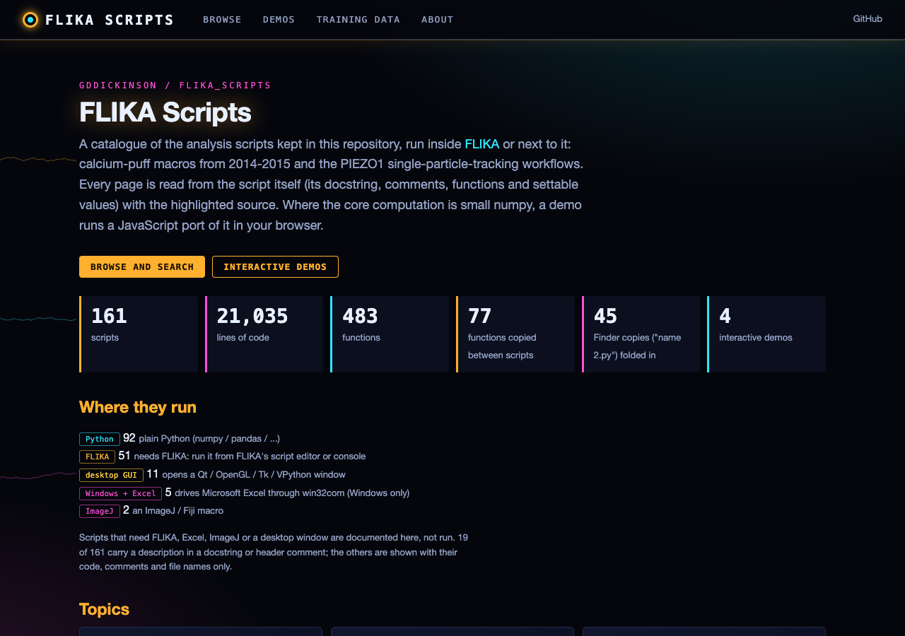
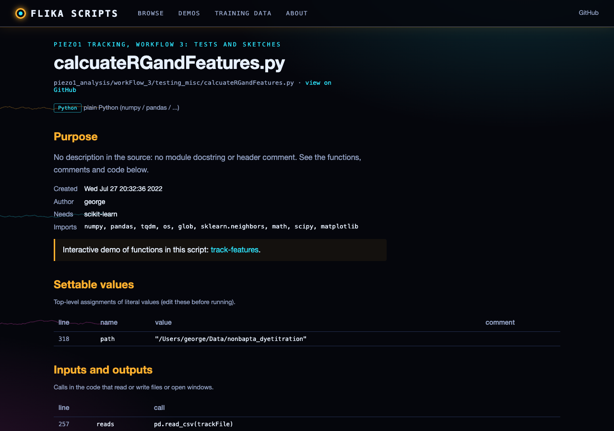
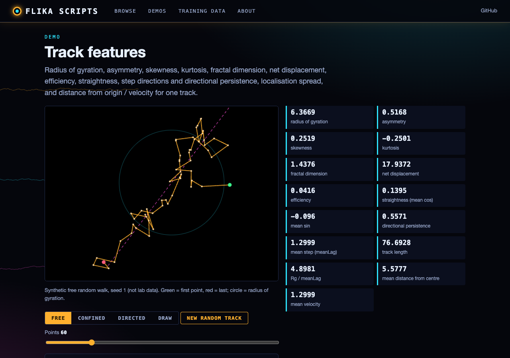

# flika_scripts
scripts to run from inside flika

## Web catalogue

A browsable, searchable catalogue of these scripts: one page per script with its purpose (taken only from its
docstring and header comments), settable values, files read and written, FLIKA steps, functions and highlighted
source, grouped by topic. Four small numpy computations (track features, neighbour counts, puff-site regrouping,
moving-average smoothing) have interactive demos that run a JavaScript port tested against the Python functions.
Scripts that need FLIKA, Excel or ImageJ are documented, not run.

Static site: https://gddickinson.github.io/flika_scripts/ (published from `master` by `.github/workflows/pages.yml`).

Run the web app locally:

```
pip install -r requirements-web.txt
python run_web.py            # http://127.0.0.1:8126
python -m pytest -q tests    # catalogue, demo fixtures, script fixes, static build, node engine tests
```

| Home | Script page |
| --- | --- |
|  |  |
| Track-features demo | Puff-site regrouping demo |
|  |  |
